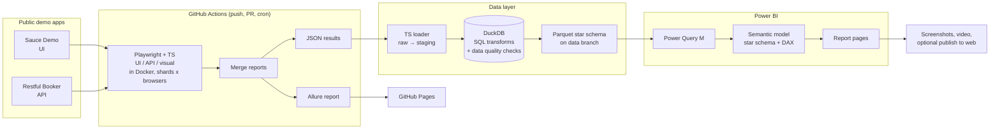

# Power BI Dashboard for Playwright

[](https://github.com/JordyR1986/powerbi-dashboard-playwright/actions/workflows/ci.yml)
[](LICENSE)

A Playwright + TypeScript suite that runs in parallel on GitHub Actions, stores every run in a star schema, and turns it into a Power BI dashboard: flaky tests, duration trends, pass rate per release and failure patterns.

> **Status:** phase 1 of 6 (setup) is done. The suite, tooling, Docker image and CI are in place. The data pipeline and the dashboard follow in later phases; see the [roadmap](#roadmap).

## Why this project

Teams run thousands of tests, but few can answer three simple questions:

- Which tests are flaky?
- Is the suite getting slower?
- Is this release better or worse than the last one?

This repository answers them with real data. A Playwright suite runs in CI against public demo apps. Every run is loaded into a small star schema, and Power BI turns that into a quality dashboard. It brings test automation and business intelligence together in one project.

The test suite started in [playwright-typescript-portfolio](https://github.com/JordyR1986/playwright-typescript-portfolio) and continues here.

## Architecture



More detail and the design decisions are in [docs/architecture.md](docs/architecture.md).

## What is in the repo today

| Area      | Contents                                                                           |
| --------- | ---------------------------------------------------------------------------------- |
| UI tests  | Sauce Demo: login, sorting, cart, checkout (Page Object Model, fixtures)           |
| API tests | Restful Booker: auth, booking CRUD, contract checks with Zod                       |
| Browsers  | Chromium, Firefox, WebKit and a Pixel 5 viewport                                   |
| Tooling   | TypeScript (strict), ESLint with Playwright rules, Prettier, EditorConfig          |
| Docker    | `Dockerfile` on the official Playwright image, pinned to the same version          |
| CI        | GitHub Actions: lint and typecheck, tests in the Playwright container, image build |

```text
tests/ui            login, sorting, cart, checkout
tests/api           auth, booking CRUD, contract checks
src/pages           page objects
src/fixtures        shopper and API fixtures
src/api             HTTP client and Zod schemas
src/data            users, catalog, customer, booking builder
src/support         checkout total rule
docs/               architecture and design decisions
Dockerfile          test image on mcr.microsoft.com/playwright
.github/workflows   CI
```

## Run locally

Requires Node.js 22.

```bash
npm ci
npx playwright install --with-deps
npm test               # API once, UI on Chromium, Firefox, WebKit and mobile Chrome
npm run test:api       # API only, no browser needed
npm run test:chromium  # API + Chromium, the quickest full check
npm run lint           # ESLint and Prettier
npm run typecheck      # tsc --noEmit
npm run report         # open the last HTML report
```

The targets are public practice systems. Credentials in `.env.example` are the published demo accounts, not secrets. Copy it to `.env` only if you want to point the suite somewhere else.

### Run in Docker

```bash
npm run docker:build
npm run docker:test    # writes playwright-report/ and test-results/ to your machine
```

The image uses the same Playwright version as `package.json`, so browsers and fonts are identical locally and in CI. That matters for the visual tests in the next phase.

## Roadmap

| Phase              | Scope                                                                                                              | Status   |
| ------------------ | ------------------------------------------------------------------------------------------------------------------ | -------- |
| 1. Setup           | New repo, suite carried over, Docker, lint and format, first green CI                                              | Done     |
| 2. Test suite + CI | Visual tests in Docker, `@smoke`/`@regression` tags, sharded matrix, merged reports, Allure on Pages, cron, `v1.0` | Next     |
| 3. Data pipeline   | JSON reporter, loader, DuckDB SQL to a star schema, data quality checks, Parquet on a `data` branch                | Planned  |
| 4. Power BI        | Power Query (M), semantic model and relationships, DAX measures, report pages, saved as PBIP/TMDL in Git           | Planned  |
| 5. Presentation    | Dashboard screenshots, short demo video, case study                                                                | Planned  |
| 6. Optional        | JMeter load test on Restful Booker, failure clustering in SQL, Microsoft Fabric Lakehouse variant                  | Optional |

## Test strategy (short)

- **Risk first.** Each test protects a decision a user or a client system can get wrong.
- **Pyramid.** API tests carry the data rules (status codes, auth, payload shape). UI tests cover what only a browser can show.
- **No hidden flakiness.** Local runs do not retry. CI retries twice, and Playwright marks a test that only passed on retry as `flaky`. That status is what the dashboard will measure.
- **Nothing skipped.** `playwright/no-skipped-test` is an error and CI sets `forbidOnly`.
- **Evidence on failure.** Trace, screenshot and video are kept when a test fails.

## Author

[@JordyR1986](https://github.com/JordyR1986): QA and data quality, test automation and business intelligence.

## License

[MIT](LICENSE)
