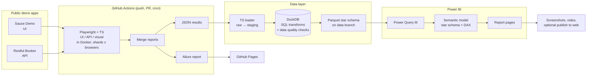

# Architecture

## Design decisions

- **Real data, not mock data.** A scheduled workflow runs the suite a few times a day. After a few weeks there are enough runs to show trends. Every Git tag (`v1.0`, `v1.1`, ...) counts as a release.
- **Flaky means Playwright's `flaky` status.** A test that failed first and passed on a retry. That is a real signal, not a home-made definition.
- **One clearly marked demo flaky test** (`@demo-flaky`) will show what flakiness looks like on the dashboard. A filter on the dashboard can hide it.
- **Storage without a server.** Parquet files on a separate `data` branch. Power BI reads them through Power Query's Web connector, so there is no database to run or pay for.
- **One container image everywhere.** Local Docker runs and CI use the official Playwright image at the same version as `@playwright/test`, so screenshots and browser behaviour match.

## Data model

The star schema (two fact tables, seven dimensions), its grain, definitions and data
quality checks are described in [data-model.md](data-model.md).
