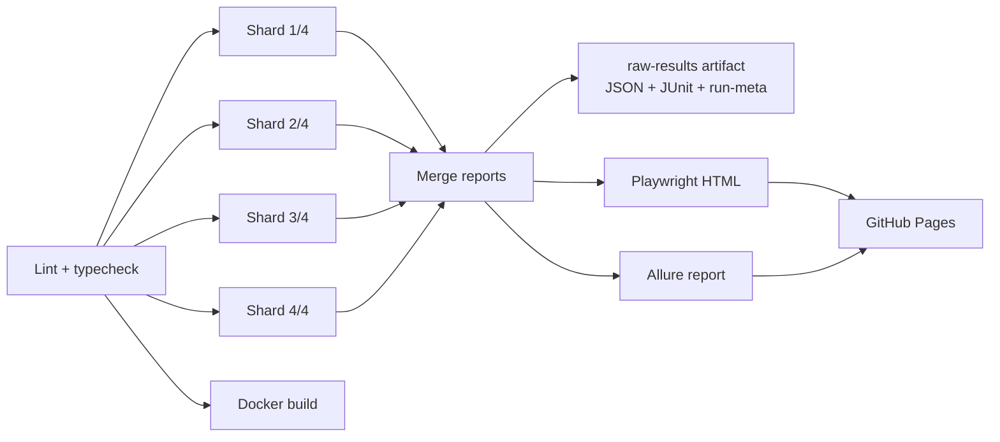

# CI pipeline

Workflow: `.github/workflows/ci.yml`.

## Triggers

| Trigger        | When                                 | Publishes to Pages |
| -------------- | ------------------------------------ | ------------------ |
| Push to `main` | Every push                           | Yes                |
| Pull request   | Every PR                             | No                 |
| Schedule       | 05:23, 11:23 and 17:23 UTC every day | Yes                |
| Manual         | Actions → CI → Run workflow          | Yes, from `main`   |

The schedule exists so the dashboard gets a steady stream of real runs. Runs on
`main` are never cancelled by a newer run, because every run is a data point.
GitHub pauses scheduled workflows in a public repository after 60 days without
activity; any push turns them back on.

## Jobs

1. **Lint and typecheck.** ESLint, Prettier and `tsc --noEmit`.
2. **Tests, 4 shards.** Every shard runs in the official Playwright image with
   `--shard=N/4`. Projects: `api`, `chromium`, `firefox`, `webkit`, `mobile-chrome`,
   `visual` and `demo`. CI retries a failed test twice, so a test that only passes on
   a retry is reported as `flaky`. Each shard uploads a blob report and its Allure results.
3. **Merge reports.** Combines the blob reports with `playwright merge-reports`
   (`merge.config.ts`) into one HTML report, `playwright-results.json` and `junit.xml`.
   It also writes `run-meta.json` (run id, trigger, commit, result, image version).
   Allure results from all shards are combined and turned into an Allure report, with
   the trend history restored from the published site.
4. **Publish to GitHub Pages.** Only from `main`. The Allure report is the home page,
   and the Playwright HTML report is under `/playwright/`.
5. **Docker image builds.** Checks the `Dockerfile` on pushes and PRs (not on the schedule).

## Artifacts

| Artifact            | Contents                                                | Kept    |
| ------------------- | ------------------------------------------------------- | ------- |
| `raw-results`       | `playwright-results.json`, `junit.xml`, `run-meta.json` | 90 days |
| `playwright-report` | Merged Playwright HTML report                           | 14 days |
| `blob-report-N`     | Per-shard blob report                                   | 3 days  |
| `allure-results-N`  | Per-shard Allure results                                | 3 days  |

`raw-results` is the input for the data pipeline in phase 3.

## Tags

| Tag            | Meaning                                                             |
| -------------- | ------------------------------------------------------------------- |
| `@smoke`       | The few checks that must pass for the shop and the API to be usable |
| `@regression`  | Everything else, including the visual tests                         |
| `@ui` / `@api` | Layer                                                               |
| `@visual`      | Screenshot comparison                                               |
| `@demo-flaky`  | The deliberately flaky demo test (see the README)                   |

Run a subset with `npm run test:smoke`, `npm run test:regression` or
`npx playwright test --grep-invert @demo-flaky`.

## Cost

Public repositories get GitHub Actions minutes for free. One run takes roughly
6–8 runner minutes in total, so three scheduled runs a day stay well within
sensible use.
