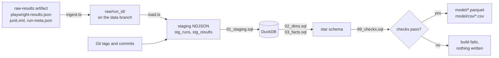
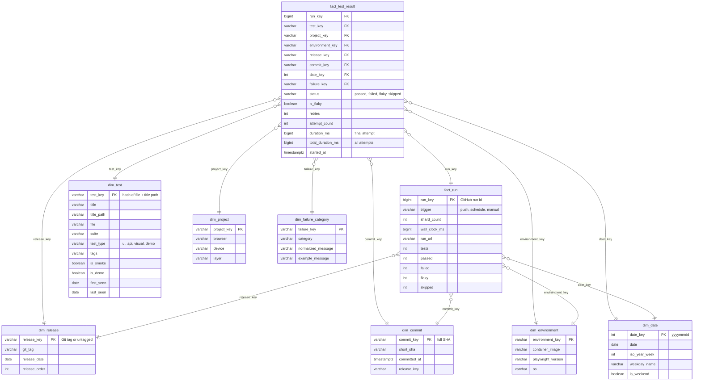

# Data model

Every CI run on `main` adds its results to a star schema. The pipeline lives in
`pipeline/` and the output is published on the [`data` branch](https://github.com/JordyR1986/powerbi-dashboard-playwright/tree/data).

## Flow



1. **Ingest** (`pipeline/ingest.ts`) copies a run's `raw-results` into `raw/<run_id>/`
   (JSON and JUnit gzipped). Storing the same run again replaces its folder, and a re-run
   attempt replaces the earlier attempt.
2. **Load** (`pipeline/load.ts`) validates the files with Zod and flattens Playwright's
   nested JSON into one row per test, project and run.
3. **Build** (`pipeline/build.ts`) runs the SQL in DuckDB, runs the data quality checks
   and only then writes Parquet and CSV. The whole model is rebuilt from the raw archive
   every time, so the result depends only on which runs are in it.

**Idempotent:** ingesting a run twice gives byte-identical Parquet and CSV files. This is
covered by `npm run test:pipeline`.

## Star schema



The diagram shows the main columns; the CSV headers list all of them.

## Grain and keys

| Table                  | Grain                                                                                | Key                              |
| ---------------------- | ------------------------------------------------------------------------------------ | -------------------------------- |
| `fact_test_result`     | One test, on one Playwright project, in one CI run (final result after retries)      | `run_key, test_key, project_key` |
| `fact_run`             | One CI run (the latest attempt if it was re-run)                                     | `run_key`                        |
| `dim_test`             | One test. Title and tags come from the latest run that saw it                        | `test_key`                       |
| `dim_project`          | One Playwright project (api, chromium, firefox, webkit, mobile-chrome, visual, demo) | `project_key`                    |
| `dim_environment`      | One combination of container image and Playwright version                            | `environment_key`                |
| `dim_release`          | One Git tag, plus `untagged` for commits before the first tag                        | `release_key`                    |
| `dim_commit`           | One tested commit                                                                    | `commit_key`                     |
| `dim_date`             | One day (UTC), without gaps between the first and last run                           | `date_key`                       |
| `dim_failure_category` | One category plus normalized message, plus `none` for passing results                | `failure_key`                    |

Keys are natural values or short hashes of them, so they stay the same on every rebuild.

**Releases** come from Git, not from the run: a run belongs to the latest tag reachable
from the commit it tested. Tagging `v1.1` later therefore labels all runs on commits
after `v1.0` correctly, including runs that were stored before the tag existed.

## Definitions

- **Status** is Playwright's final outcome: `expected` → `passed` (or `skipped`),
  `unexpected` → `failed`, `flaky` stays `flaky` (failed first, passed on a retry).
- **Pass rate** = `(passed + flaky) / (passed + flaky + failed)`. Skipped results do not
  count. A flaky test passed in the end, so it counts as passed; the flaky rate shows it
  separately.
- **Flaky rate** = `flaky / (passed + flaky + failed)`.
- **Duration** is the final attempt (`duration_ms`); `total_duration_ms` includes retries,
  which is what the run actually spent.
- **Failure category** is decided by the first matching rule on the error message:
  visual diff → network → locator → timeout → assertion → other. For a failed test the
  last attempt's error is used, for a flaky test the first failing attempt's.
  `normalized_message` replaces numbers and quoted values so equal problems group together.
- **Dates** are UTC.

## Data quality checks

`pipeline/sql/99_checks.sql` runs after every build. If any check finds a problem the
build stops and nothing is written, so the data branch never gets a broken model.

- The fact grain is unique, and every run has exactly one `fact_run` row.
- Every run has at least one result.
- Durations are not negative.
- `status` is a known value and `is_flaky` matches it.
- Failed and flaky results have a failure category.
- Run totals add up, and match Playwright's own summary.
- The JUnit testcase count matches the JSON results.
- No orphan keys: every foreign key exists in its dimension.
- Every dimension key is unique.

## Files on the data branch

| Path                  | Contents                                                      |
| --------------------- | ------------------------------------------------------------- |
| `raw/<run_id>/`       | `run-meta.json`, `playwright-results.json.gz`, `junit.xml.gz` |
| `model/*.parquet`     | The nine tables above (zstd compressed)                       |
| `model/csv/*.csv`     | The same tables as CSV                                        |
| `model/manifest.json` | Build time, number of runs, row counts and check results      |

The data branch always holds a single commit. The raw archive inside it is the history,
and the model is rebuilt from it on every run, so the branch does not grow with every
version of the Parquet files.

Power BI reads the files over HTTPS, for example
`https://raw.githubusercontent.com/JordyR1986/powerbi-dashboard-playwright/data/model/fact_test_result.parquet`.

## Running it locally

```bash
# store one or more downloaded raw-results folders
npm run data:ingest -- --raw .data/raw path/to/raw-results
# rebuild the model
npm run data:build -- --raw .data/raw --out .data/model
# or build the same snapshot as CI, without pushing
PUSH=false bash scripts/publish-data.sh path/to/raw-results
```

## Backfill

_Actions → Backfill dataset → Run workflow_ downloads the `raw-results` artifact of
recent CI runs on `main` (artifacts are kept for 90 days) and adds them to the data
branch. It is safe to run more than once.
